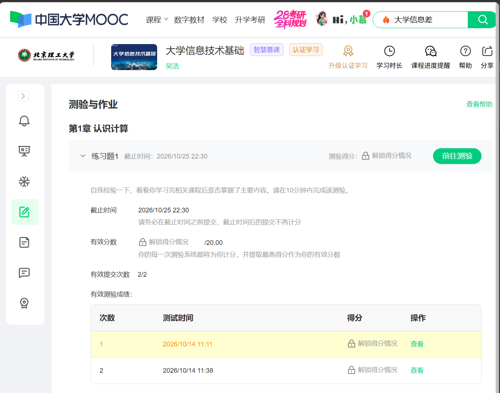
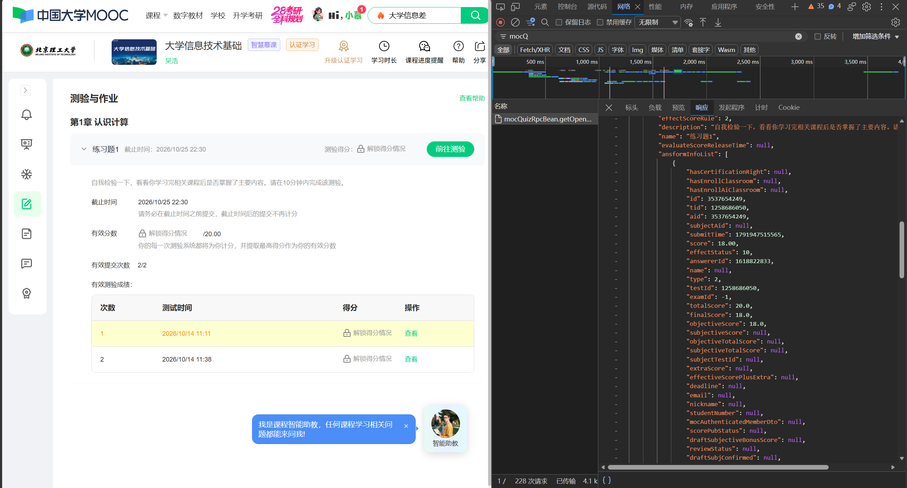

做完测验后到如图界面：

在这个界面：

按F12，打开开发者工具

在 开发者工具 中，最上面一行点击 网络

此时在原网页界面中右键刷新

刷新后再开发者工具中的筛选器的搜索框中搜mocQuizRpcBean.getOpenQuizInfo.rpc(输前几个字符就可以看到了)

单击那条搜索结果，看到如图界面

点击 响应/Response

在弹出的代码中根据你这次测验的标题找到 "name":"xxx"  这一行，比如图里面的就是 "name":"练习题1"

单次测验的分数就在name那一行后面的花括号{}里的一堆代码中，一对花括号{}代表一次，越往后是越新的一次，成绩就是花括号中第9行的"score": xx.xx,

ps.手机端可以直接看到，本Blog只是给各位找个乐子
