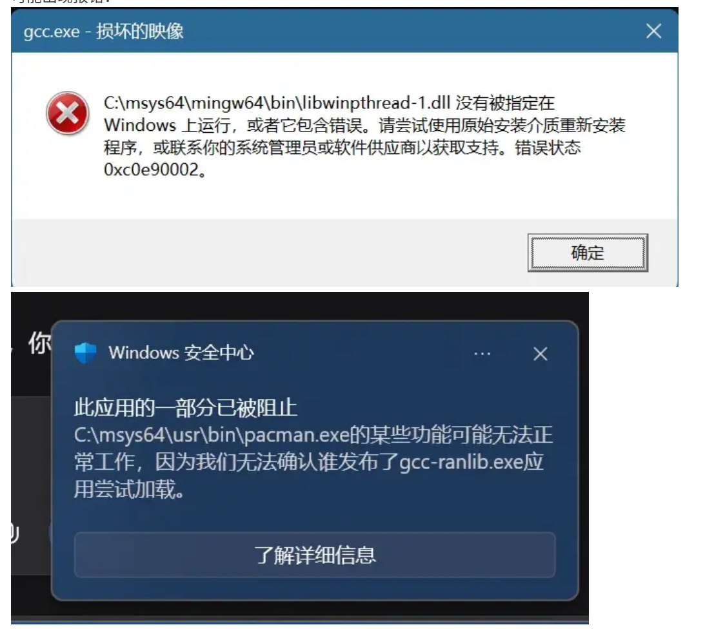
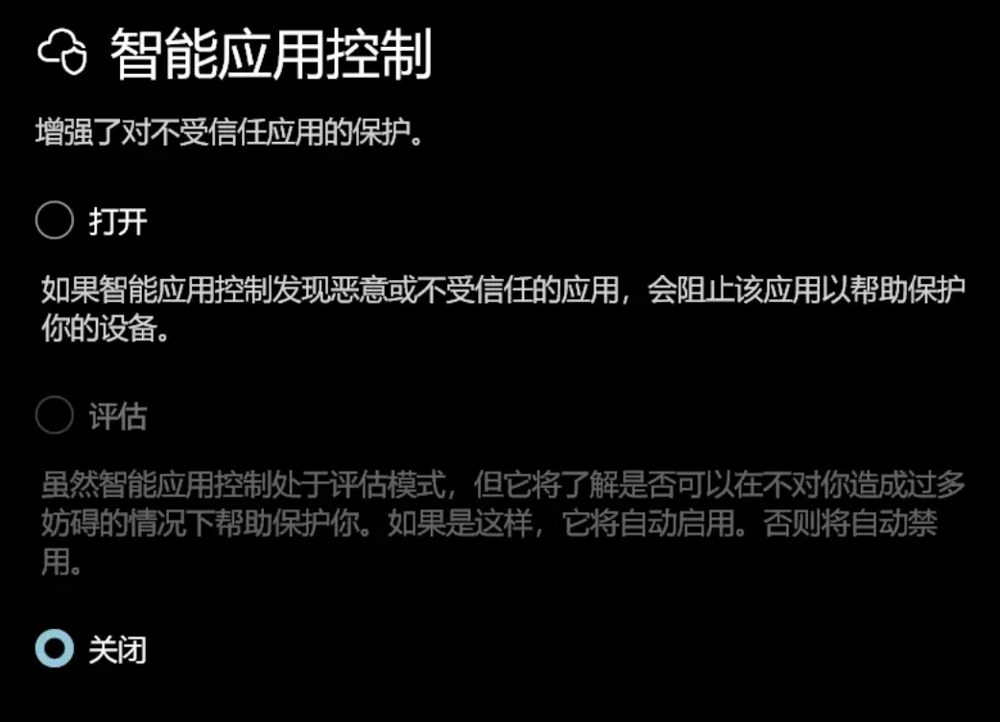

笔者在参考林粒粒呀的c语言教学视频[](https://www.bilibili.com/video/BV1L4z3YaENw)进行c语言环境配置时遇到了一些问题，于是有了这篇blog。

在msys2终端使用 pacman -S --need base-devel mingw-w64-x86_64-toolchain 命令下载mingw工具链时，由于下载源在国外导致下载速度奇慢，容易出现以下报错：

```text
error: failed retrieving file 'binutils-2.47-1-x86_64.pkg.tar.zst' from mirror.msys2.org : The requested URL returned error: 404
error: failed retrieving file 'mingw-w64-x86_64-sqlite3-3.53.4-1-any.pkg.tar.zst' from mirror.msys2.org : The requested URL returned error: 404
error: failed retrieving file 'mingw-w64-x86_64-ncurses-6.6-4-any.pkg.tar.zst' from mirror.msys2.org : The requested URL returned error: 404
warning: too many errors from mirror.msys2.org, skipping for the remainder of this transaction error: failed retrieving file 'mingw-w64-x86_64-isl-0.28-1-any.pkg.tar.zst' from mirror.msys2.org : The requested URL returned error: 404
error: failed retrieving file 'mingw-w64-x86_64-pcre2-10.47-1-any.pkg.tar.zst.sig' from repo.msys2.org : Operation too slow. Less than 1 bytes/sec transferred the last 10 seconds
error: failed retrieving file 'mingw-w64-x86_64-ncurses-6.6-4-any.pkg.tar.zst.sig' from repo.msys2.org : Operation too slow. Less than 1 bytes/sec transferred the last 10 seconds
error: failed retrieving file 'mingw-w64-x86_64-isl-0.28-1-any.pkg.tar.zst.sig' from repo.msys2.org : Operation too slow. Less than 1 bytes/sec transferred the last 10 seconds
warning: too many errors from repo.msys2.org, skipping for the remainder of this transaction error: failed retrieving file 'mingw-w64-x86_64-sqlite3-3.53.4-1-any.pkg.tar.zst.sig' from repo.msys2.org : Operation too slow. Less than 1 bytes/sec transferred the last 10 seconds
error: failed retrieving file 'binutils-2.47-1-x86_64.pkg.tar.zst' from repo.msys2.org : HTTP/2 stream 1 reset by server (error 0x2 INTERNAL_ERROR)
warning: failed to retrieve some files
error: failed to commit transaction (unexpected error)
Errors occurred, no packages were upgraded.
```

与deepseek周旋过后总结出以下低风险的换源下载方法（无需代理）：

*以下操作在msys2的ucrt64终端中经过验证运行，实测有效，终端可在windows任务栏搜索打开

## 1.备份原有镜像配置

```bash
cp /etc/pacman.d/mirrorlist.msys /etc/pacman.d/mirrorlist.msys.bak
cp /etc/pacman.d/mirrorlist.mingw64 /etc/pacman.d/mirrorlist.mingw64.bak
```

## 2.替换为清华镜像源（也可选择其他）

使用 sed 批量替换（适用于所有 mirrorlist* 文件）：

```bash
sed -i 's|https\?://mirror.msys2.org|https://mirrors.tuna.tsinghua.edu.cn/msys2|g' /etc/pacman.d/mirrorlist*
sed -i 's|https\?://repo.msys2.org|https://mirrors.tuna.tsinghua.edu.cn/msys2|g' /etc/pacman.d/mirrorlist*
```

其他国内镜像源地址（任选其一替换上述 https://mirrors.tuna.tsinghua.edu.cn/msys2 ）：

中科大：https://mirrors.ustc.edu.cn/msys2

阿里云：https://mirrors.aliyun.com/msys2

网易：https://mirrors.163.com/msys2

## 3.更新包数据库并重试安装

```bash
pacman -Scc        # 清理所有缓存包
pacman -Syyu        # 强制刷新所有仓库元数据并更新系统（可选）
pacman -S --needed base-devel mingw-w64-x86_64-toolchain
```

MSYS2 安装完成后，桌面或开始菜单会有好几个终端快捷方式（如 MSYS2 MSYS、MSYS2 MINGW64、MSYS2 UCRT64）。  ***你需要打开 MSYS2 MINGW64（或 UCRT64），而不是默认的 MSYS2 MSYS，***  否则调用的可能是 MSYS 自带的 Linux 兼容层编译器。

## 确认编译器版本和路径:

在 MSYS2 MINGW64 终端中执行:

```bash
# 查看 GCC 版本
gcc --version
```

你应该能看到类似 gcc (Rev2, Built by MSYS2 project) 14.x.x 的版本信息。

但有时输入这行代码可能没有输出，经过排查可能是防病毒软件或安全软件静默拦截了 gcc.exe 的执行。如果进行如下操作后出现图示弹窗，基本可以确定是这个问题。

确认操作:
打开 Windows 的 命令提示符（Win+R 输入 cmd），然后运行（注意使用反斜杠路径）：
*该gcc路径仅用于示例，具体安装路径请自行查找

```cmd
C:\msys64\mingw64\bin\gcc.exe --version
```

可能出现报错：



这可以通过手动调整windows安全中心的设置来解决。

### 1.打开 windows安全中心，选择 应用与浏览器控制

### 2.进入 智能应用控制设置 ，选择 关闭



这样大概率可以解决问题。

只要再次在 MSYS2 MINGW64 终端中执行:

```bash
# 查看 GCC 版本
gcc --version
```

看到类似 gcc (Rev2, Built by MSYS2 project) 14.x.x 的版本信息，说明gcc环境已经配置完成，问题解决。
