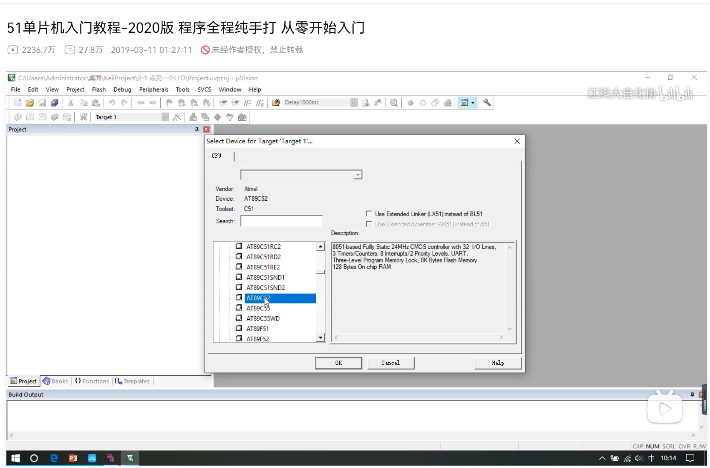
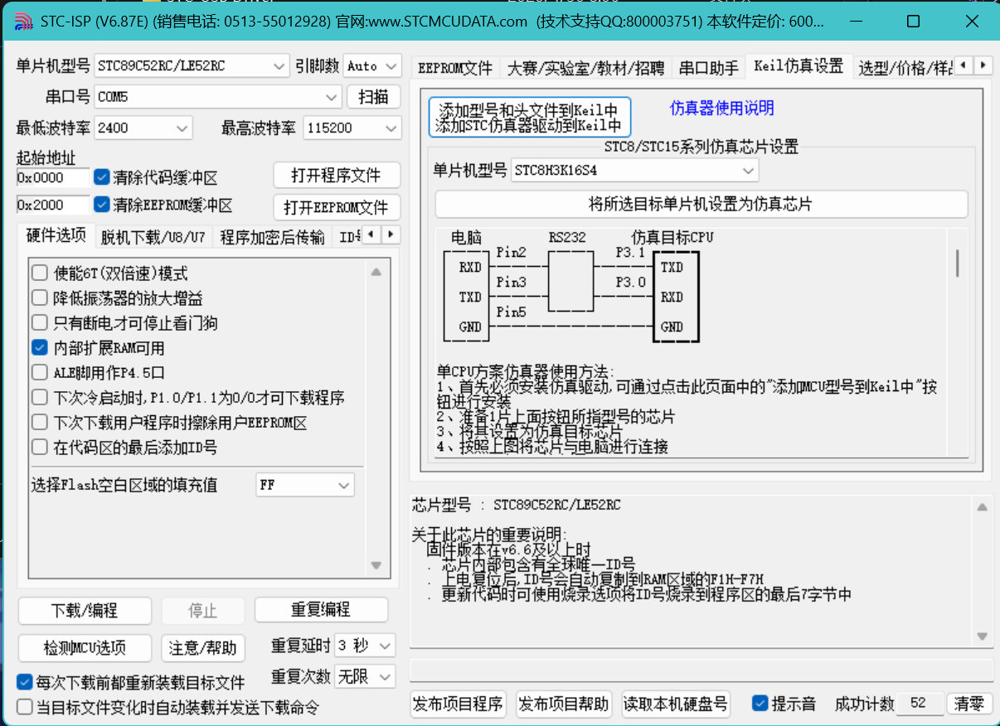
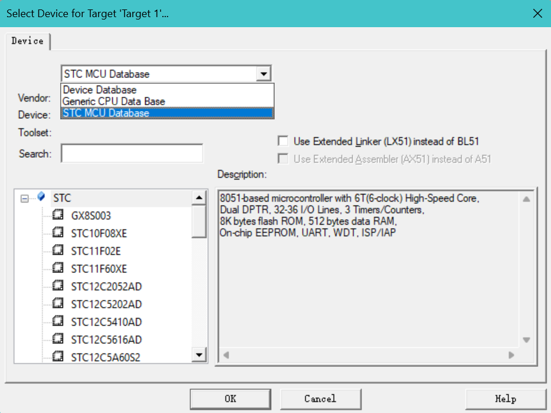

介于初学者在网络上买到的板子大部分是STC89C51和STC89C52故以此为例讨论解决方法。



在大部分人按照江协科技的视频在新建项目select device时选择Atmel的AT89C51后，可能会在程序写好进行Build时遇到如下报错：
（当然，按照弹幕  ***Atmel 2016年就被 Microchip 收购 现在新的 Keil 里 AT89C51 系列都在 Microchip目录下***  的说法，应该选 Microchip 的 AT89C51，不过一样会报错）

```text
Error: *** Project '1.0.1', Target 'Target 1', Device 'Atmel::AT89C51RC2' is not supported by Toolchain ! ***.
```

这个报错的成因比较复杂，总之就是不兼容。在此博客中笔者仅对解决方法进行讨论，不对报错原因做出深究。

以下为解决方法：

## 用stc-isp给Keil 51添加仿真器步骤

打开scp-isp

在右上方导航栏中找到 ***Keil仿真设置***



点击 ***添加型号和头文件到Keil中 添加STC仿真器到Keil中*** 即可

## 注意事项

上述操作相当于让keil 51认识了你买的国产芯片，而不是江协科技的“找了个长得像的”，因此在后续写程序的部分操作上与江协科技有所不同，如下：

### 1.新建项目时的select device环节



先要在最上面的白色候选框中选中 ***STC MCU Database***

再在底下直接按照原名选择芯片即可

### 2.编写程序时的头文字引入

既然keil 51已经认识你的芯片了，那么头文字就不用照抄江协科技的，直接右键空白处点击Insert'\#include \<STC89C5xRC.H\>'就可以

### 3.程序关键字不同

头文件不同关键字自然可能不同，比如江协的P2_2的写法在STC89C5xRC.H里面就是P22,部分函数也不一样。总之不要照抄江协的代码，先在头文件里查一下。
